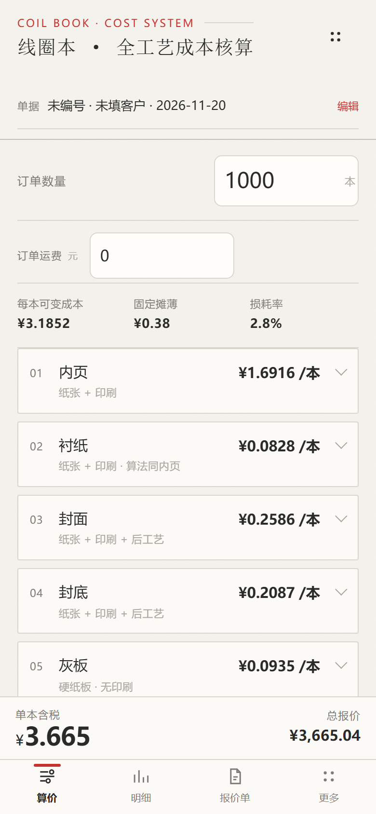
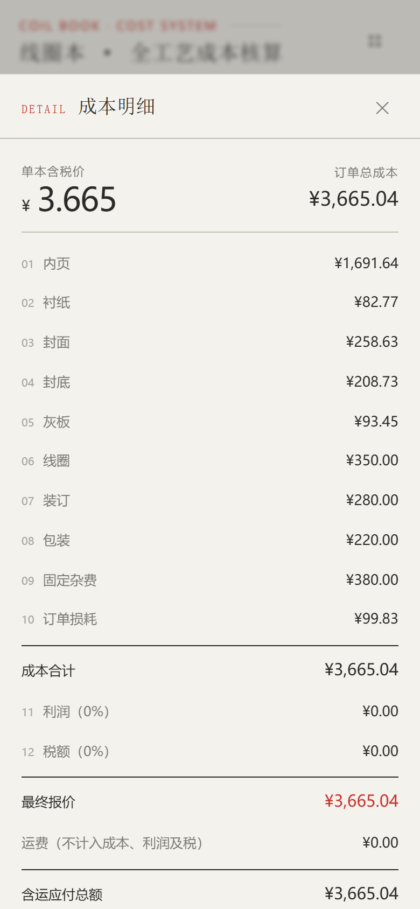
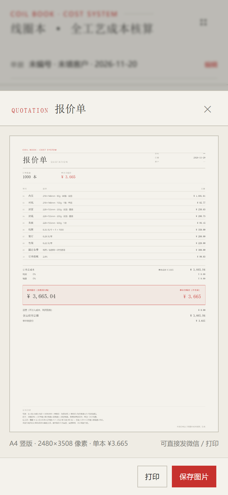

# 线圈本成本核算 · Margin

印刷厂**线圈本全工艺成本核算与报价**工具，Windows 桌面与 Android 双端共用同一套计价引擎：
内页 / 衬纸 / 封面 / 封底 / 灰板的纸张与印工、覆膜烫金 UV 等后工艺、线圈装订包装、订单损耗、利润与税，
一次算出单本成本与含税报价，并可直接生成给客户看的报价单。

界面走「纸感规格书」路线：暖纸底、发丝线、衬线数字、无圆角无阴影——像一张印刷规格单，而不是 SaaS 面板。



> 手机端：单栏 + 常驻价格条，8 个模块卡片化。详见下文「手机端界面」。

## 功能

**算价**
- 8 个模块：`01 内页` `02 衬纸` `03 封面` `04 封底` `05 灰板` `06 线圈·装订·包装` `07 固定杂费与损耗` `08 利润与税`
- 后工艺：覆膜（面积计价 + 最低 60 元兜底）、烫金 / UV（按手计价）
- 运费**单列**：可录入，但不计入成本、利润与税；另给含运应付合计与单本到货价
- 利润分档按**成本加成**口径（明确命名，不与销售毛利率混淆）

**效率**
- 方案库：不同客户 / 批量各存一套参数，一键切换
- 预设库：常用纸种、吨价、工艺单价的档位速填
- 报价单：A4 竖版（2480×3508）一键生成 PNG，可直接发微信或打印

**录入**
- 文本识图：订单单 / 规格表拍照识别，**本地离线 OCR 与云端视觉可切换**
- AI 助手：一句话填参、成本体检、成本加成测算；只覆盖识别到的字段，不整单重置

**可靠性**
- 输入安全校验：非法 / 越界 / 非法枚举会被拦截，存在安全错误时暂停显示有效报价并阻断导出
- 存储失败会明确报错，不再虚报「已保存」
- 备份导出自动**剔除密钥**；导入前校验结构与版本，失败回滚

## 快速开始

```bash
npm install
npm run prepare:assets   # 从 node_modules 复制离线 OCR 引擎到 public/tess
npm run dev              # http://127.0.0.1:5199
```

> `public/tess/` 里的 tesseract 引擎（约 7.5MB）不入库，`prepare:assets` 是幂等的，`npm run build` 会自动前置执行。

## 计算口径

| 项目 | 公式 |
| --- | --- |
| 纸张张价 | 长(m) × 宽(m) × 克重(g/m²) × 吨价(元/吨) ÷ 1,000,000 |
| 每本用纸 | 张价 × 每本张数 × (1 + 纸张损耗%) |
| 拼版印张 | ⌈订单数 × 每本张数 ÷ 拼版数⌉ + 备损张数 |
| 印次 | 印张 × (单面 1 / 双面 2) |
| 印刷费 | 上机费 + 印次 × 印工单价，再 ÷ 订单数 摊到每本 |
| 覆膜 | max(长 × 宽 × 0.38 × 订单数 × 1.1, 60) |
| 烫金 / UV | (订单数 ÷ 拼版数) × 单价 |
| 订单总成本 | [各模块每本 + 线圈 + 装订 + 包装 + 固定杂费÷订单数] × 订单数 × (1 + 订单损耗%) |
| 利润 / 税 | 均以**订单总成本**为基数上浮（非售价倒扣） |
| 运费 | 单列展示，不计入以上任何一项 |

说明：
- **备损张数只影响印刷费，不另计纸材**；纸材损耗由「纸张损耗%」承担，避免重复计算。
- 封面 / 封底烫金 UV 的「手数」按 `订单数 ÷ 拼版数` 计算（可带小数），印张数才向上取整。

## 构建

### Windows 安装包

```bash
npm run dist:win
```

产物：`release/CoilBookCost-Setup-<version>.exe`（NSIS，可选安装目录、带卸载）。
页面通过自定义 `app://` 协议加载——这样 `Worker` 与 `fetch` 可用，离线 OCR 才能在打包后真正工作。

### Android APK

前置：JDK 21、Android SDK（compileSdk 36 / build-tools 35）、`android/local.properties` 指向 SDK。

```bash
npx cap sync android            # 在项目根执行
cd android && ./gradlew assembleRelease
```

release 包使用 Android 默认的 **debug 签名**——仓库与文档都不包含任何签名证书。

如果需要对外分发、并且希望新版本能覆盖旧安装，请自行配置 `signingConfig`，并保证每次构建都用同一份证书；否则签名变化会导致设备上装不上去，必须先卸载旧版。

## 测试与验收

```bash
npm test            # 单元测试（计算口径、参数安全、存储、AI/OCR 解析、运费）
npm run verify      # 类型检查 + 单测 + 构建 + 桌面/手机画幅探针
npm run verify:ocr  # 追加离线 OCR 实证（黑洞 CDN 后仍能识别）
```

`verify` 会用无头浏览器跑程序化探针，断言设计令牌（纸地色、零圆角、等宽数字）、8 模块编号、
关键金额、桌面双栏 / 手机底部栏断点、无横向溢出等，而不是靠肉眼。

## 手机端界面：单栏 + 常驻价格条

手机版不是桌面双栏的等比缩小。核心判断是**价格必须一直看得见**——报价员的动作循环是「改一个参数 → 看单本价变没变」，把结果放进需要跳转的页面，等于每次改动都付一次导航成本。

| 算价 | 成本明细 |
| --- | --- |
|  |  |

| 报价单 | 更多 |
| --- | --- |
|  |  |

- **常驻价格条**：单本含税（无衬线 30sp + 等宽数字）+ 总报价，吸在底部不动。
- **4 个顶级入口**：算价 / 明细 / 报价单 / 更多。一次性动作（预设、识图、AI、设置、重置）收进「更多」的 录入 / 存档 / 工具 / 危险 四组，不再和目的地混排。
- **单据信息折叠成一行摘要**（单号 · 客户 · 日期），点开才展开 4 个字段。
- **模块卡片化**：8 个模块各一张纸卡片，折叠时露出 `¥/本`，点开就地展开字段，不需要跳页。
- **触控与形状**：可点元素一律 ≥48dp；单据容器 2px 直角、控件 8px 圆角、标签 pill —— 形状本身在区分「这是纸」和「这是能按的」。

桌面端的网格、衬线标题与零圆角照旧：上面这些规则全部写在 `@media (max-width: 900px)` 内，两端互不影响。

> 截图为 390×844 手机画幅下的真实渲染（无头 Edge 从 `dist` 构建产物截取，非设计稿、非生图）。
> 设计过程、令牌修正（次墨对比度 3.76:1 → 4.63:1）、与 Material 3 Expressive 的取舍，见 [docs/android-redesign.md](docs/android-redesign.md)；可看的 v0 设计稿保留在 [docs/v0/](docs/v0/)。

## 目录结构


```
src/
  engine/     计算引擎（纯函数）：calc / validate / defaults / types
  ui/         界面组件与配置化表单（schema 驱动 8 个模块）
  ai/         OpenAI 兼容客户端、字段白名单与解析
  store/      本地存储、密钥（系统安全存储）、备份导入导出
  export/     报价单 Canvas 渲染、文件保存（浏览器 / Capacitor）
  styles/     设计令牌与版面
electron/     Electron 主进程（app:// 协议）、preload、safeStorage 桥
android/      Capacitor 工程、Keystore 插件
tests/        单元测试
tools/        资源准备、静态服务、一键验收探针
docs/         安卓端设计稿（android-redesign.md 说明 + v0/ 源码与截图）
```

## 隐私与安全

- API Key 存放于**系统安全存储**（Windows `safeStorage` / Android Keystore），不落明文文件；旧版明文会在设置页迁移并清除。
- 密钥**绑定接口地址与用途**，AI 与云端识图不会互相复用；请求强制 HTTPS 且禁止重定向。
- AI / 云端识图只在你点击时发起请求，密钥会作为 Bearer 发送给**你所配置的服务商**。
- 备份文件不含任何密钥。
- 无遥测。

## 版本

| 版本 | 日期 | 主要变更 |
| --- | --- | --- |
| **1.2.4** | 2026-11-22 | 更新源改为「GitHub 优先、Gitee 兜底」：两个源自动切换，Gitee 上的大安装包按 90MB 分片发布，客户端下载后拼接并校验 SHA-256 |
| 1.2.3 | 2026-11-22 | 「检查更新」打开即自动检查、只留一个按钮；仓库地址与 Token 收进默认折叠的「高级设置」 |
| 1.2.2 | 2026-11-22 | 桌面端新增「更多」入口（成本分档/参数自检/检查更新/恢复默认此前在 Windows 上进不去）；面板打开时冻结背后页面滚动 |
| 1.2.1 | 2026-11-22 | 发布整理：Android 改用调试证书签名、文档不再描述演进来源；修正「同版本重装后收不到更新提示」（检查更新只认更高版本号）。无功能变更 |
| 1.2.0 | 2026-11-21 | 修复 Windows 覆盖安装失败（旧卸载器的目录改名缺陷）；新增两端自动检查更新，从 GitHub Release 拉取安装包 |
| 1.1.1 | 2026-11-21 | 动效补丁：折叠面板弹簧展开、浮层补上退场动画、按钮按压回弹（两端同步） |
| 1.1.0 | 2026-11-20 | 手机端重构：单栏 + 常驻价格条 + 算价/明细/报价单/更多 四个入口；8 模块卡片化；单据折叠成一行摘要。桌面端界面与内核未变，仅版本号对齐 |
| 1.0.0 | 2026-11-19 | 首个 Windows + Android 双端版本 |

完整更新公告见 [CHANGELOG.md](CHANGELOG.md)。

- Android 包名 `com.coilbook.cost`，`versionCode 8` / `versionName 1.2.4`，使用调试证书签名（不提供正式签名证书）。
- 桌面端从 1.0.0 / 1.1.x **可以直接覆盖安装**（1.2.0 起修复了旧卸载器导致的升级失败）。
- 1.2.4 APK：8,001,836 字节，SHA-256 `A3F96F039A38658F38FC7F7BC00757A607D2E957C1028A4E67F24A1C5739F9E9`。
- 1.2.4 安装包：149,529,126 字节，SHA-256 `21D839FC182BF5D508845026AFB98EBA77461BB31A298A48447A94D28AE57C52`。
- 发布页（GitHub，优先）：<https://github.com/Neutron-Fair/Margin/releases/tag/v1.2.4>
- 发布页（Gitee，备用）：<https://gitee.com/neutronfair/Margin/releases/tag/v1.2.4>

## 更新源

「更多 → 检查更新」默认先查 GitHub Release；GitHub 连不上时自动改用 Gitee 镜像，用户不需要做任何设置。

| 源 | 用途 | 说明 |
| --- | --- | --- |
| GitHub `Neutron-Fair/Margin` | 优先 | 安装包单文件直接下载 |
| Gitee `neutronfair/Margin` | 兜底 | 附件单文件上限 100MB，因此 Windows 安装包按 90MB 切成 `.part1/.part2`；客户端下载后拼接，并按发布说明里的 SHA-256 校验 |

发布两端用两个脚本：`tools/publish-release.ps1`（GitHub）、`tools/publish-gitee.ps1`（Gitee，自动切片 + 上传清单）。

## 已知限制

- Windows 安装包**未做代码签名**，首次运行可能被 SmartScreen 提示。
- 本地 OCR 使用 tesseract，对模糊、手写、复杂排版的识别率有限；准确率要求高时建议切云端视觉。
- 识图的自然语言解析是保守启发式，复杂表述可能识别不准，**填参后请人工核对**。
- 已在 Android 14 x86_64 模拟器验证，尚未在 ARM 真机与各厂商 ROM 上全面验证。
- 报价口径来自实际业务单页，若与你的计费习惯不同，请先核对上文「计算口径」。
